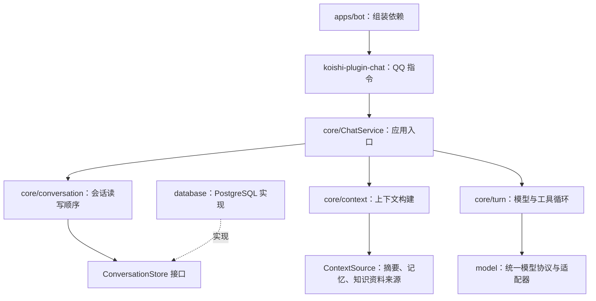

# AI 对话系统模块设计

onxbot 将平台消息接入、会话持久化、上下文构建、单轮执行和模型协议分开。参考 ChatLuna 的会话 / 运行时 / 上下文划分，采用 AstrBot 的 Provider 与执行循环分层；人格和参考资料的组织参考 SillyTavern。

## 模块与依赖



`@onxbot/model` 独立为 workspace 包：模型协议可以在其他应用中复用，不依赖会话或 Koishi。会话、上下文和执行模块放在 `@onxbot/core` 的独立目录中，当前共同构建。存储通过 `@onxbot/core/conversation` 导入所需接口。

| 模块                 | 接口                                          | 负责的行为                                                                 |
| -------------------- | --------------------------------------------- | -------------------------------------------------------------------------- |
| `koishi-plugin-chat` | Koishi 指令                                   | 解析 `/chat`、`/reset`，识别消息身份，发送普通文本和用户错误提示           |
| `core/ChatService`   | `execute(request)`                            | 输入校验，请求分派，连接下面三个模块                                       |
| `core/conversation`  | `reply(request, generate)`、`reset(identity)` | 在会话锁内读取历史、执行当前回合、原子保存成功回合；失败不保存半个回合     |
| `core/context`       | `build(request)` → `PreparedContext`          | 组合人格、上下文来源、完整历史回合和当前输入；每次模型请求前重新应用预算   |
| `core/turn`          | `run(context)` → `TurnResult`                 | 请求模型，执行已注册工具，追加工具结果，继续请求直到最终文本或达到次数限制 |
| `model`              | `ModelProvider.generate(request)`             | 将统一消息 / 工具定义转换成模型协议，校验响应，返回文本或工具调用          |
| `database`           | `ConversationStore.withConversation()`        | 实现会话锁、事务、完整回合查询和消息持久化                                 |

## 一次回合的执行

1. 接入模块将 QQ 消息转换成 `ChatRequest`，身份包含 `platform / botId / channelId / userId`。
2. `ChatService` 校验正文，交给 `ConversationService`。
3. 存储锁定当前身份，读取最近 N 个完整回合。不同身份可以并发。
4. `ContextBuilder` 加载当前身份的上下文来源，生成本轮使用的 `PreparedContext`。
5. `TurnRunner` 在每次模型请求前调用 `context.messages(output)`，将本轮新增内容一起纳入预算。
6. 模型返回工具调用时，执行器只查找已注册工具，解析 JSON 参数，通过 Zod 校验后执行，按顺序追加结果。
7. 模型给出最终回复后，会话模块一次写入用户消息和本轮所有 assistant / tool 消息，提交事务。
8. 接入模块发送最终回复。平台发送位于数据库事务之后；发送失败不会自动重做模型请求或外部工具。

工具异常、模型请求失败、上下文超限或超过模型请求次数，都会使本轮数据库写入回滚。外部工具已经产生的效果无法由 PostgreSQL 撤销，因此执行器不自动重试工具；具有写入副作用的工具应自行提供幂等和超时策略。当前应用默认不注册工具。

## 消息与历史

模型协议使用四种消息：

- `system`：人格与行为设定，由上下文构建器提供。
- `user`：用户消息；上下文来源以带名称的参考资料消息提供。
- `assistant`：模型文本，也可携带 `toolCalls`。
- `tool`：工具结果，通过 `toolCallId` 关联模型调用。

一个回合从一条用户消息开始，到最终 assistant 回复结束，中间可以有多个工具调用与结果。`CHAT_HISTORY_TURNS` 按完整回合计算，而非按消息条数计算。

数据库保留原有会话和消息表。增量迁移 `002-tool-messages` 为消息增加 `tool_calls jsonb` 和 `tool_call_id text`，扩展角色约束，原有 user / assistant 历史可继续读取。人格、参考资料和本次裁剪结果不写入原始聊天记录；工具调用与工具结果随回合持久保存。

目前身份直接绑定一条会话，`/reset` 清除这条会话的消息。跨服务实例恢复依赖 PostgreSQL，不依赖内存缓存。

## 上下文策略

默认顺序是人格、带名称的参考资料、最近完整回合、当前输入、本轮已产生的工具调用与结果。来源在每个用户回合加载一次，本轮模型多次请求复用同一份资料。

`ContextSource.load({ identity, input })` 是摘要、长期记忆和知识检索的接入位置。来源负责根据身份与当前问题查询资料，构建器负责组合内容。来源对象不应缓存上一个用户的检索结果。资料按 `user` 参考消息提供，不授予其 `system` 指令角色。

可选 `ContextBudget` 接受 `maxTokens` 和 `countTokens(messages)`。装配者根据实际模型提供计数器，并提前从窗口中预留输出和工具定义的 token。每次请求超限时，构建器从最旧的完整历史回合开始移除；人格、资料和当前回合仍超限时，返回可理解的输入错误，不拆散工具调用与结果。

当前 bot 默认使用 `CHAT_HISTORY_TURNS`，尚未配置模型专用 token 计数器。摘要生成、长期记忆提取和向量检索尚未内置；它们有明确接入位置，不以空实现模拟已具备的能力。

## 装配与扩展

`apps/bot` 是装配位置。下面示例展示如何增加一个经过参数校验的只读工具：

```ts
import { ContextBuilder, TurnRunner, defineTool } from '@onxbot/core';
import { z } from 'zod';

const context = new ContextBuilder({
  systemPrompt: '你是一个简洁的中文助手。',
  historyTurns: 10,
  sources: [
    {
      name: '用户偏好',
      async load({ identity }) {
        return preferences.describe(identity);
      },
    },
  ],
});

const runner = new TurnRunner(model, {
  maxModelCalls: 8,
  tools: [
    defineTool({
      name: 'weather',
      description: '查询指定城市的天气',
      input: z.object({ city: z.string().min(1) }),
      async execute({ city }) {
        return weatherClient.forecast(city);
      },
    }),
  ],
});
```

`preferences`、`weatherClient` 和 `model` 由应用提供。核心不会自行创建数据库连接或查询任意外部地址。

## 后续能力放置

| 能力                 | 放置位置与持久化决策                                                                            |
| -------------------- | ----------------------------------------------------------------------------------------------- |
| 自动摘要             | 独立摘要生成模块与摘要表，以摘要覆盖到的消息 ID 标记进度；由 `ContextSource` 读取，保留原始记录 |
| 用户长期记忆         | 独立记忆模块，记录事实、来源和归属；与频道历史分开，明确是否允许跨频道使用                      |
| 知识检索             | 独立检索来源，返回本轮相关片段；需要语义检索时再引入 embedding 与向量存储                       |
| 新建 / 切换对话      | 会话模块增加活动会话绑定；将现有身份唯一约束迁到绑定表，使身份与 thread 分离                    |
| 群聊共享上下文       | 在接入与会话路由处明确共享策略；保留消息作者与引用关系，个人记忆权限单独处理                    |
| 取消、排队和持久执行 | 执行模块管理 run 状态；长任务需要独立运行记录与恢复协议，避免等待期间占用事务                   |

当前的 PostgreSQL 行锁覆盖整个回合，包括上下文来源和模型 / 工具执行，连接池上限为 10。它保证多进程下同一身份串行；更高吞吐或长任务需要在存储模块替换这一执行策略。

## 参考

- [ChatLuna 会话服务](https://chatluna.chat/development/api-reference/conversation-service.html)、[运行时](https://chatluna.chat/development/api-reference/conversation-runtime.html)、[上下文管理](https://chatluna.chat/development/api-reference/llm-core/context-manager.html)。
- [AstrBot Agent 执行方式](https://docs.astrbot.app/use/agent-runner.html)、[上下文压缩](https://docs.astrbot.app/use/context-compress.html)。
- [SillyTavern Prompt Manager](https://docs.sillytavern.app/usage/prompts/prompt-manager/)、[World Info](https://docs.sillytavern.app/usage/core-concepts/worldinfo/)。
- [OpenAI Function Calling](https://developers.openai.com/api/docs/guides/function-calling)。
